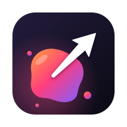
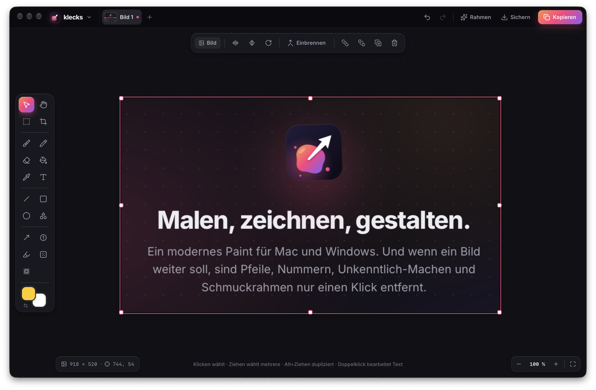

<p align="center">
  
</p>

<h1 align="center">Klecks</h1>

<p align="center">
  <b>Ein modernes Paint für macOS und Windows.</b><br>
  Alles, was das klassische Paint kann, in einer zeitgemäßen Oberfläche.<br>
  Dazu die Extras, mit denen ein Bild in Sekunden bereit zur Weitergabe ist.
</p>

<p align="center">
  <a href="https://github.com/wl-lankin/klecks/releases/latest/download/Klecks-macOS.dmg"><b>Download für macOS</b></a>
  &nbsp;·&nbsp;
  <a href="https://github.com/wl-lankin/klecks/releases/latest/download/Klecks-Windows-Setup.exe"><b>Download für Windows</b></a>
  &nbsp;·&nbsp;
  <a href="https://github.com/wl-lankin/klecks/releases">Alle Versionen</a>
</p>

<p align="center">
  
</p>

## Malen und zeichnen

- **Pinsel** in vier Varianten: rund, Kalligrafie, weicher Airbrush, Sprühdose. Mit Grafiktablett reagiert er auf Stiftdruck.
- **Stift** mit harten Pixeln wie im klassischen Paint, **Radierer**, **Fülleimer** mit einstellbarer Toleranz, **Pipette**.
- **Zwei Farben**: Linksklick malt mit der ersten, Rechtsklick mit der zweiten. Palette, zuletzt benutzte Farben, Hex-Eingabe und freie Farbwahl.
- **Linien, Rechtecke, Ellipsen und Formen**: Dreieck, rechtwinkliges Dreieck, Raute, Fünf- und Sechseck, Stern, Herz, Sprechblase, Blockpfeil, Haken, Kreuz. Formen bleiben Objekte. Du kannst sie jederzeit verschieben, skalieren, umfärben, füllen, stricheln und mit Schatten versehen.
- **Text** in vier Schriften (Inter, Handschrift, Serif, Mono), frei, auf farbigem Etikett oder mit Kontur, die auf jedem Hintergrund lesbar bleibt.
- **Auswählen**: Rechteck oder Lasso, Bereich herausheben und verschieben, kopieren, ausschneiden, leeren, zuschneiden. ⌘A bzw. Strg+A wählt wie in Paint das ganze Bild.
- **Bild bearbeiten**: zuschneiden (frei, 1:1, 16:9, 4:3), Bildgröße, Zeichenfläche mit Anker, drehen, spiegeln, Farben umkehren, Graustufen.
- **Dateien**: Öffnen per Dialog oder Drag & Drop. Speichern als PNG, JPEG, WebP oder BMP. Mehrere Bilder öffnest du als Tabs mit Vorschaubild.
- **Neue Leinwand** in gängigen Größen. Liegt ein Bild in der Zwischenablage, schlägt Klecks dessen Maße vor.

## Extras für die Weitergabe

- **Schwungpfeile**: Am mittleren Griff ziehst du sie in einen Bogen. Dazu klassische, offene und Doppelpfeile.
- **Nummern** für Schritt-für-Schritt-Anleitungen. Jeder Klick setzt die nächste Zahl.
- **Textmarker**, der wie ein echter Leuchtstift über Text liegt.
- **Unkenntlich machen**: Namen, E-Mail-Adressen oder Passwörter verpixeln oder weichzeichnen.
- **Spotlight**: Ein Bereich bleibt hell, der Rest wird abgedunkelt.
- **Schmuckrahmen**: Farbverlauf, Rand, abgerundete Ecken und Schatten, als Vorschau direkt im Bild.
- **Kopieren** (⇧⌘C bzw. Strg+Shift+C oder der Knopf oben rechts) legt das fertige Bild in die Zwischenablage. Von dort fügst du es direkt in Chat, Mail oder Ticket ein, ganz ohne Speichern.

Klecks liest die Zwischenablage nur, wenn du selbst einfügst. Beim Anlegen einer neuen Leinwand fragt es lediglich die Maße eines dort liegenden Bildes ab. Im Hintergrund liest Klecks nie mit.

## Bedienung

| Aktion | macOS | Windows |
|---|---|---|
| Befehlspalette (alle Befehle durchsuchen) | ⌘K | Strg+K |
| Alle Tastenkürzel | ? | ? |
| Fertiges Bild kopieren | ⇧⌘C | Strg+Shift+C |
| Einfügen / als neues Bild einfügen | ⌘V / ⇧⌘V | Strg+V / Strg+Shift+V |
| Rückgängig / Wiederholen | ⌘Z / ⇧⌘Z | Strg+Z / Strg+Y |
| Einpassen / Originalgröße | ⌘0 / ⌘1 | Strg+0 / Strg+1 |
| Ansicht verschieben | Leertaste halten | Leertaste halten |

Jedes Werkzeug hat einen eigenen Buchstaben, z. B. B für Pinsel, A für Pfeil, T für Text. Fährst du mit der Maus über ein Werkzeug, siehst du sein Kürzel. Beim Zeichnen rastet **Shift** Winkel und Proportionen ein, **Alt** zeichnet von der Mitte aus, **Alt+Ziehen** dupliziert, und **+ / −** ändern die Werkzeuggröße.

Das Design, hell oder dunkel, folgt dem System. Umschalten kannst du unter „Ansicht“ oder in der Befehlspalette.

## Installation

**macOS** (Apple Silicon und Intel, ab macOS 12): DMG öffnen und Klecks in „Programme“ ziehen. Klecks ist noch nicht von Apple notarisiert. Beim ersten Start deshalb per Rechtsklick auf Klecks „Öffnen“ wählen oder unter Systemeinstellungen → Datenschutz & Sicherheit auf „Trotzdem öffnen“ klicken.

**Windows** (10 und 11, 64 Bit): Installer starten. Solange der Installer nicht signiert ist, meldet sich SmartScreen. Klicke dann auf „Weitere Informationen“ und „Trotzdem ausführen“.

**Updates** kommen automatisch und unterbrechen nie deine Arbeit. Auf dem Mac gilt die neue Version ab dem nächsten Start, unter Windows wird sie beim Beenden installiert. Steht ein Update bereit, zeigt die Titelleiste „Neu starten“.

## Entwicklung

Klecks ist mit [Tauri 2](https://tauri.app), Rust und TypeScript gebaut, ohne UI-Framework. Gezeichnet wird mit Canvas 2D.

```bash
npm install
npm run tauri dev      # App mit Live-Reload
npm run build          # Typprüfung und Frontend-Build
npm run pack           # installierbare App bauen
```

| Ordner | Inhalt |
|---|---|
| `src/` | Oberfläche, Werkzeuge, Renderer, Verlauf (Undo/Redo als Pixel-Patches) |
| `src/ui/` | Titelleiste, Werkzeugleiste, Eigenschaftsleiste, Dialoge, Befehlspalette |
| `src-tauri/` | Rust: Dateien, Zwischenablage, native Menüleiste, Updater |
| `assets/` | Logo als SVG; `npm run icons` erzeugt daraus alle App-Icons |

Wie Releases und automatische Updates funktionieren, steht in [docs/RELEASE.md](docs/RELEASE.md).

## Lizenz

[MIT](LICENSE). Klecks wurde entwickelt von [Wolfgang Linz](https://wolfgang-linz.de).
